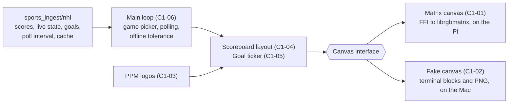

# Architecture

How the scoreboard is put together. Decisions are in [`adr/`](adr/README.md).

> **Status:** written in C1-00. C1-01 added the matrix layer and its `lib/` paths, and C1-02 the
> fake canvas for the Mac; the rest is still plan. When code lands and differs, update this file in the same PR.

## Data flow

| Layer | Responsibility | Must not |
|---|---|---|
| **sports_ingest** | Fetch, parse and cache NHL data (its [repo](https://github.com/BryceARich/sports_ingest)) | — |
| **Main loop** | Choose the game, poll at an adaptive rate, survive network loss | Draw pixels |
| **Layout and ticker** | Turn game state into draw calls | Fetch data, or know which canvas it has |
| **Canvas** | Set pixel, fill, draw text in a BDF font, swap on vsync | Know about hockey |
| **Assets** | Read P6 PPM logos, pre-sized to 20×20 | Need a native image library |

## Display

The canvas is 128×32. The left 64 columns hold the logos, period, clock and score; the right
64 hold the scrolling goal ticker. Panels and matrix options are in
[`RESUME.md`](RESUME.md#hardware-setup).

## What exists now

| Path | Contents |
|---|---|
| `script/licensed-data-guard`, `script/lib/`, `.githooks/` | Licensed-data guard and its pre-commit hook |
| `.claude/commands/`, `script/claude/` | `/spawn_unblocked`, `/work_issue` and their helpers |
| `spec/` | RSpec specs |
| `bin/setup` | Ruby, gems and hook |
| `bin/hello_panels` | Draws "hello" on the panels (C1-01) |
| `bin/fake_panels` | Draws "hello" and/or a team logo (`--logo avalanche`) on the fake canvas for the terminal or a PNG (C1-02, C1-03) |
| `assets/logos/` | 32 team logos, 20×20 PPM, made by `script/import_logos` ([ADR 0004](adr/0004-ppm-logos-presized.md)) (C1-03) |
| `lib/nhl_scoreboard/` | `Matrix`, `Canvas`, `Font`, `MatrixSettings` (C1-01); `native.rb` and `native/` are the only C binding ([ADR 0002](adr/0002-ffi-to-librgbmatrix.md)) |
| `lib/nhl_scoreboard/` (fake) | `FakeMatrix`, `FakeCanvas`, `BdfFont`, `PngEncoder`: pure Ruby, no C ([ADR 0003](adr/0003-pure-ruby-fake-canvas.md)) (C1-02) |
| `.github/` | Issue and PR templates; `workflows/ci.yml` (licensed-data guard, specs and lint) |

App paths are added here by the issues that create them.
